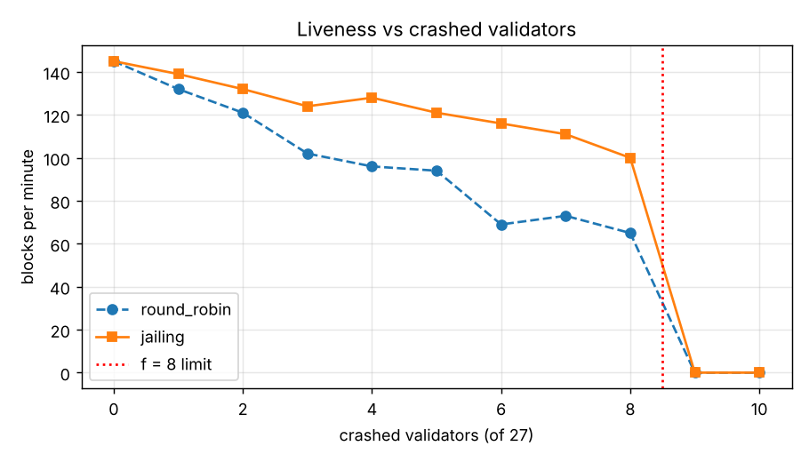
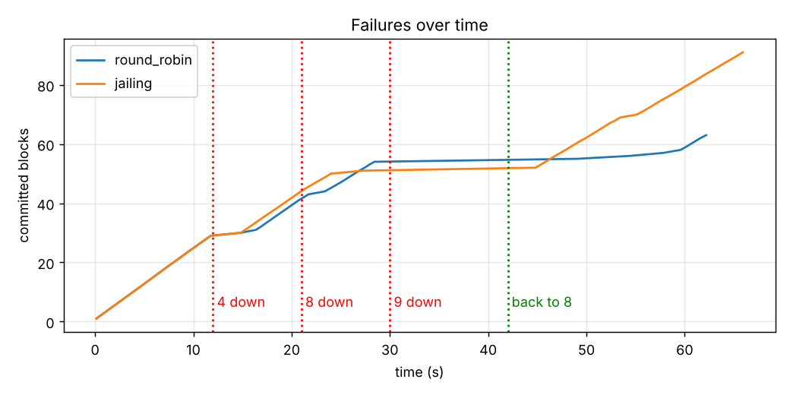
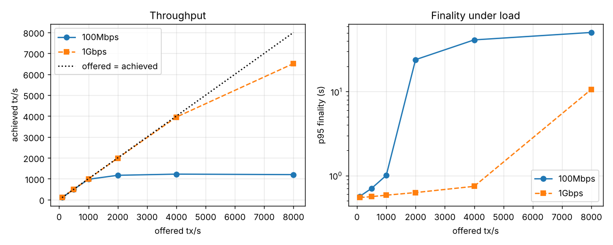
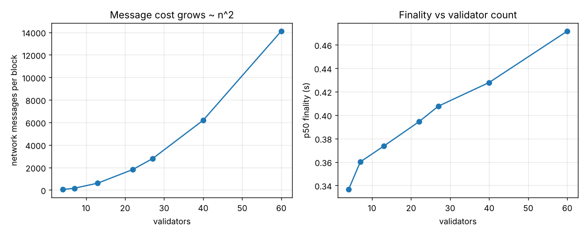
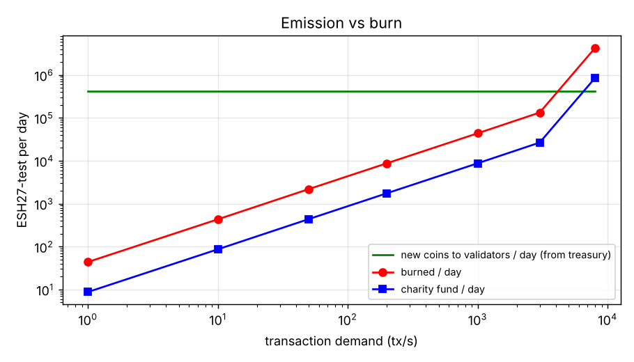
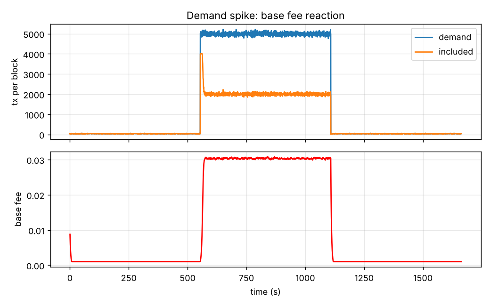

# CHAIN27 Lab: דוח ניסויים

נוצר אוטומטית על ידי `run_experiments.py`. כל ריצה נמשכת 60 שניות של זמן מדומה, עם seed קבוע, כך שהתוצאות ניתנות לשחזור. הרשת היא הדמיה במחשב אחד, לא רשת אמיתית. המספרים מראים מגמות ומגבלות, ולא ביצועים של מוצר.

## קו בסיס: 27 צמתים תקינים

| מדד | ערך |
|---|---|
| בלוקים בדקה | 145 |
| זמן בין בלוקים (ממוצע) | 0.416 שניות |
| סופיות עסקה, חציון / 95% | 0.408 / 0.597 שניות |
| עסקאות בשנייה (ביקוש 200) | 202.6 |
| הודעות רשת לבלוק | 2,779 |
| עלות אימות חתימת Ed25519 (נמדד) | 107 מיקרו-שניות |
| פיצולים (forks) | 0 |
| בדיקת היצע 270M | תקין |

## עמידות: כמה צמתים יכולים ליפול

| צמתים שנפלו | בלוקים בדקה, סבב רגיל | בלוקים בדקה, עם השעיה | סופיות 95%, עם השעיה |
|---|---|---|---|
| 0 | 145 | 145 | 0.60 |
| 1 | 132 | 139 | 0.62 |
| 2 | 121 | 132 | 0.87 |
| 3 | 102 | 124 | 1.30 |
| 4 | 96 | 128 | 1.17 |
| 5 | 94 | 121 | 1.28 |
| 6 | 69 | 116 | 2.41 |
| 7 | 73 | 111 | 1.73 |
| 8 | 65 | 100 | 1.79 |
| 9 | 0 | 0 | - |
| 10 | 0 | 0 | - |

**ממצאים:**
- הרשת ממשיכה לייצר בלוקים עם עד 8 צמתים שנפלו, ונעצרת לגמרי ב-9, כמו שהתיאוריה צופה (f = 8 עבור 27 צמתים, נדרשים 19 קולות).
- בסבב מציעים רגיל, כל צומת שנפל מבזבז סבב שלם כשמגיע תורו. עם 8 צמתים שנפלו: 65 בלוקים בדקה. עם השעיה של מציע שנכשל (100 בלוקים): 100. זה המימוש הפשוט של "מדד האמינות" מה-Whitepaper 1.1, והוא נגזר רק מבלוקים שכבר נחתמו, כך שכל הצמתים מסכימים עליו.
- גם עם השעיה, כשנשארים בדיוק 19 צמתים חיים, כל בלוק מחכה לצומת האיטי ביותר מביניהם, והסופיות עולה.

## נפילה הדרגתית לאורך זמן

4 צמתים נופלים, אחר כך 8, אחר כך 9 (עצירה), ואז צומת אחד חוזר. בלוקים שנחתמו: 63 בסבב רגיל, 91 עם השעיה. פיצולים: 0. אחרי שצומת חוזר והרשת שוב ב-19 צמתים, היא ממשיכה מאותה נקודה בלי התערבות ידנית. בסבב רגיל ההתאוששות איטית, כי הסבב ממשיך לעבור דרך 8 הצמתים שעדיין למטה. עם השעיה הם מדולגים.

**באג שהמעבדה מצאה ושתוקן:** בגרסה הראשונה, אחרי שצומת חזר הרשת נשארה תקועה לתמיד. הקולות שנשלחו אליו בזמן שהיה למטה אבדו, ובלי הקול שלו אף צומת לא הגיע ל-19. הפתרון: צומת שתקוע באותו גובה יותר משנייה שולח שוב את הקולות שלו. רשתות אמיתיות (Tendermint, CometBFT) עושות את זה כל הזמן. זה בדיוק מסוג הדברים שקל לפספס כשבונים קונצנזוס מאפס.

## צמתים זדוניים (equivocation)

צומת זדוני שולח הצעות וקולות סותרים לחצאים שונים של הרשת. צמתים ישרים שמקבלים שני קולות סותרים מאותו צומת שומרים ראיה. הראיה נכנסת לבלוק, ו-10% מהסטייק של הצומת נשרפים.

| זדוניים | בלוקים | פיצולים | ראיות שנאספו | צמתים שנקנסו |
|---|---|---|---|---|
| 0 | 145 | 0 | 0 | 0 |
| 2 | 143 | 0 | 286 | 2 |
| 4 | 139 | 0 | 560 | 4 |
| 6 | 135 | 0 | 821 | 6 |
| 8 | 130 | 0 | 1056 | 8 |
| 9 | 1 | 0 | 13 | 0 |
| 10 | 0 | 0 | 97 | 0 |
| 12 | 1 | 0 | 65 | 4 |

**ממצאים:** עד 8 זדוניים, הרשת חיה, בלי פיצולים, והתוקפים נקנסים ומושעים. מ-9 ומעלה היא נעצרת. בניסוי הזה לא נוצר פיצול גם מעל הסף, אבל זה בגלל שאסטרטגיית התקיפה פשוטה. מעל 8 זדוניים אין שום הבטחה תיאורטית לבטיחות.

## עומס ורוחב פס

| רוחב פס | ביקוש tx/s | בפועל tx/s | סופיות 95% | MB לבלוק |
|---|---|---|---|---|
| 100Mbps | 100 | 100 | 0.57 | 0.68 |
| 100Mbps | 500 | 494 | 0.70 | 1.93 |
| 100Mbps | 1000 | 977 | 1.00 | 4.57 |
| 100Mbps | 2000 | 1,167 | 23.98 | 134.65 |
| 100Mbps | 4000 | 1,223 | 41.25 | 137.01 |
| 100Mbps | 8000 | 1,200 | 50.59 | 142.85 |
| 1Gbps | 100 | 101 | 0.55 | 0.68 |
| 1Gbps | 500 | 497 | 0.56 | 1.71 |
| 1Gbps | 1000 | 995 | 0.58 | 3.06 |
| 1Gbps | 2000 | 1,986 | 0.63 | 6.04 |
| 1Gbps | 4000 | 3,950 | 0.74 | 13.17 |
| 1Gbps | 8000 | 6,512 | 10.64 | 26.45 |

**ממצאים:**
- צוואר הבקבוק הוא רוחב הפס של המציע. הוא שולח את הבלוק לכל 26 הצמתים האחרים, ולכן כל עסקה נשלחת 26 פעמים.
- ב-100Mbps התפוקה נעצרת סביב 1,223 עסקאות בשנייה. מעבר לזה התור רק גדל, והסופיות קופצת מפחות משנייה לעשרות שניות (עד 51). בלוק גדול לוקח יותר זמן לשדר מזמן ההמתנה להצעה, ולכן חלק מהסבבים מתבזבזים. התיקון: להגביל את גודל הבלוק לפי רוחב הפס, או להאריך את זמן ההמתנה לפי גודל הבלוק.
- ב-1Gbps התקרה עולה לכ-6,512. מעבר לזה צריך הפצה בשרשור (gossip) של חלקי בלוק במקום שליחה ישירה לכולם.

## השהיית רשת

| השהיה חציונית (ms) | זמן בין בלוקים | סופיות חציון | סופיות 95% | סבבים נוספים |
|---|---|---|---|---|
| 5 | 0.289 | 0.188 | 0.319 | 0 |
| 20 | 0.343 | 0.285 | 0.436 | 0 |
| 40 | 0.416 | 0.408 | 0.597 | 0 |
| 80 | 0.560 | 0.661 | 0.917 | 0 |
| 150 | 0.818 | 1.115 | 1.493 | 0 |
| 300 | 1.367 | 2.051 | 2.714 | 0 |

**ממצא:** כל בלוק דורש כ-3 מעברים ברשת (הצעה, קול מקדים, קול סופי), ולכן הסופיות גדלה בערך פי 3 מההשהיה. כשההשהיה מתקרבת לזמני ההמתנה של הפרוטוקול, מתחילים סבבים מבוזבזים. בפריסה בין יבשות צריך להגדיל את זמני ההמתנה.

## מספר הצמתים

| צמתים | הודעות לבלוק | MB לבלוק | סופיות חציון |
|---|---|---|---|
| 4 | 43 | 0.06 | 0.337 |
| 7 | 160 | 0.14 | 0.360 |
| 13 | 610 | 0.33 | 0.374 |
| 22 | 1,826 | 0.71 | 0.394 |
| 27 | 2,779 | 0.97 | 0.408 |
| 40 | 6,195 | 1.75 | 0.428 |
| 60 | 14,110 | 3.48 | 0.472 |

**ממצא:** מספר ההודעות גדל בערך בריבוע מספר הצמתים, כי כל צומת שולח קול לכל צומת אחר. 27 צמתים זה גודל נוח. במאות צמתים צריך לאגד חתימות (BLS).

## כלכלת המטבע ESH27-test

| ביקוש tx/s | נכנס בפועל tx/s | עמלה בסוף | נשרף ביום | הונפק ביום | לצדקה ביום | שינוי נטו במחזור ביום |
|---|---|---|---|---|---|---|
| 1 | 1 | 0.0010 | 44 | 415,685 | 9 | 415,641 |
| 10 | 10 | 0.0010 | 433 | 415,685 | 87 | 415,252 |
| 50 | 50 | 0.0010 | 2,185 | 415,685 | 437 | 413,500 |
| 200 | 200 | 0.0010 | 8,756 | 415,685 | 1,751 | 406,929 |
| 1000 | 998 | 0.0010 | 43,770 | 415,685 | 8,754 | 371,915 |
| 3000 | 2,997 | 0.0010 | 132,966 | 415,685 | 26,593 | 282,719 |
| 8000 | 4,818 | 0.0206 | 4,260,909 | 415,685 | 852,182 | -3,845,223 |

**ממצאים:**
- עם תגמול של 2.0 מטבעות לבלוק ובלוק כל 0.42 שניות, יוצאים מהאוצר 152 מיליון מטבעות בשנה הראשונה. האוצר (108 מיליון) מתרוקן אחרי 0.7 שנים, גם עם חצייה שנתית. כדי שהאוצר יחזיק לנצח עם חצייה שנתית, התגמול צריך להיות לכל היותר 0.712 לבלוק.
- השריפה עולה על ההנפקה רק בעומס גבוה מאוד, כי העמלה הבסיסית יורדת לרצפה כשהבלוקים לא מלאים. במילים אחרות: ברשת צעירה המטבע הוא אינפלציוני, והדפלציה שהובטחה ב-Whitepaper 1.0 תלויה בביקוש גבוה.
- בקפיצת ביקוש, העמלה עולה תוך דקות (שיא 0.031) ומסננת עסקאות, ואחרי הקפיצה היא חוזרת לרצפה.
- הדמיית הכלכלה לא מגבילה רוחב פס. בפועל, ב-100Mbps הרשת לא מחזיקה יותר מכ-1,200 עסקאות בשנייה (ראה סעיף העומס), ולכן השורות של 3,000 ו-8,000 הן תיאורטיות.
- הקרן לצדקה מקבלת 10% מהעמלות בלבד, ולכן בעומס נמוך היא כמעט ריקה. אם הקרן חשובה, כדאי לשקול גם נתח קבוע מתגמולי הבלוק.

## מגבלות המעבדה

- הדמיה בתהליך אחד. הרשת, ההשהיות ועלויות ה-CPU מדומות לפי מודל. קריפטוגרפיה אמיתית נמדדת רק בבנצ'מרק, ואין חתימה בפועל על כל הודעה.
- המאגר (mempool) משותף, וכל עסקה נחשפת לכל הצמתים אחרי השהיה אחת.
- צומת שחוזר מקבל העתק של השרשרת מצומת ישר (סנכרון מופשט).
- תוקף זדוני אחד בלבד מסוג אחד (equivocation). אין התקפות רשת, אין שוחד ואין קנוניה מתוחכמת.
- הכלכלה מניחה ביקוש פשוט: לכל עסקה יש עמלה מקסימלית אקראית.

זמן ריצה: 55 שניות.
