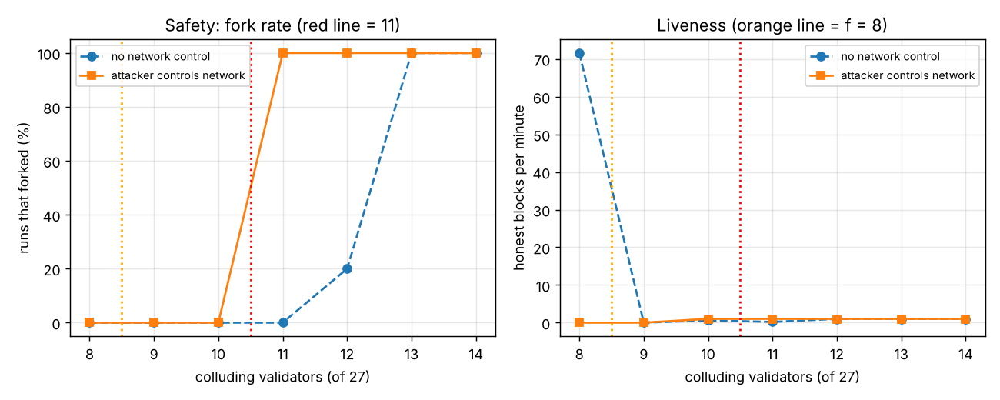

# ניסוי 02: קנוניה של צמתים זדוניים

נוצר על ידי `exp_attack.py`. 27 מאמתים, מניין חוקי של 19 קולות. 5 הרצות לכל הגדרה, כל אחת 60 שניות מדומות, עם קבוצת תוקפים אקראית אחרת בכל הרצה.

## התקיפה

התוקפים פועלים כגוף אחד שרואה את כל הרשת. הם מחלקים את הצמתים הישרים לשני חצאים, X ו-Y. כשתור ההצעה מגיע לאחד מהם, הוא שולח בלוק A לחצי X ובלוק B לחצי Y, וכל התוקפים מצביעים בעד A מול X ובעד B מול Y. בסבבים של מציע ישר הם מצביעים "nil", כדי שהסבבים ימשיכו להתקדם עד שיגיע התור שלהם. נבדקו שני מצבים: בלי שליטה ברשת, ועם שליטה ברשת, שבה התוקף חוסם כל תקשורת בין X ל-Y.

## השערות

1. **חיות:** עד 8 תוקפים הרשת ממשיכה לייצר בלוקים. מ-9 היא נעצרת, כי לישרים לבד אין 19 קולות.
2. **בטיחות:** עד 10 תוקפים אי אפשר לפצל את הרשת, באף מצב. כל שני מניינים של 19 מתוך 27 חולקים לפחות 11 צמתים, ולכן פיצול דורש ש-11 צמתים יחתמו על שני בלוקים סותרים.
3. **מ-11 תוקפים עם שליטה ברשת:** פיצול בכל הרצה.
4. **מ-11 תוקפים בלי שליטה ברשת:** פיצול לא מובטח. צמתים ישרים מעבירים הלאה קולות שקיבלו, וכך חושפים את הקולות הכפולים של התוקפים לפני שהמניין נסגר.
5. **אחריותיות:** אחרי כל פיצול אפשר להוכיח מי אשם, לפחות 11 צמתים, ואף צומת ישר לא מואשם.

## תוצאה

| תוקפים | שליטה ברשת | הרצות שהתפצלו | בלוקים בדקה | סבבי תקיפה | אשמים שהוכחו (מינימום) | ישרים שהואשמו |
|---|---|---|---|---|---|---|
| 8 | לא | 0% | 71.6 | 26.4 | - | - |
| 9 | לא | 0% | 0.0 | 5.4 | - | - |
| 10 | לא | 0% | 0.6 | 4.0 | - | - |
| 11 | לא | 0% | 0.2 | 5.6 | - | - |
| 12 | לא | 20% | 1.0 | 1.0 | 12 | 0 |
| 13 | לא | 100% | 1.0 | 1.0 | 13 | 0 |
| 14 | לא | 100% | 1.0 | 1.0 | 14 | 0 |
| 8 | כן | 0% | 0.0 | 0.6 | - | - |
| 9 | כן | 0% | 0.0 | 0.2 | - | - |
| 10 | כן | 0% | 1.0 | 1.0 | - | - |
| 11 | כן | 100% | 1.0 | 1.0 | 11 | 0 |
| 12 | כן | 100% | 1.0 | 1.0 | 12 | 0 |
| 13 | כן | 100% | 1.0 | 1.0 | 13 | 0 |
| 14 | כן | 100% | 1.0 | 1.0 | 14 | 0 |

## מסקנות

1. **חיות: אושרה.** עם 8 תוקפים הרשת ממשיכה (72 בלוקים בדקה, לעומת 144 בלי תוקפים), כי התוקפים מבזבזים כל סבב שבו הם מציעים. מ-9 תוקפים היא נעצרת כמעט לגמרי.
2. **בטיחות עד 10: אושרה.** בין 9 ל-10 תוקפים יש "אזור ביניים": הרשת עצורה, אבל אין פיצול. זו התכונה החשובה של BFT: כשיש יותר מדי תוקפים, הרשת מעדיפה לעצור ולא לייצר היסטוריה סותרת.
3. **מ-11 עם שליטה ברשת: אושרה.** הפיצול קורה כבר בסבב התקיפה הראשון, תוך שניות. אחרי הפיצול שני החצאים נעצרים, כי לאף אחד מהם אין 19 קולות ישרים לבלוק הבא.
4. **מ-11 בלי שליטה ברשת:** 11 תוקפים: 0%, 12 תוקפים: 20%, 13 תוקפים: 100%, 14 תוקפים: 100%. ב-11 התוקפים צריכים את כל 11 הקולות שלהם בכל צד. מספיק שקול כפול אחד שהועבר הלאה יגיע לפני הקול הישיר, והתקיפה נכשלת. ככל שיש יותר תוקפים יש להם יותר מרווח, והסיכוי לפיצול עולה. המסקנה המעשית: פיזור גאוגרפי וחיבורים ישירים בין כל הצמתים מקשים מאוד על תוקף שלא שולט ברשת.
5. **אחריותיות: אושרה.** בכל פיצול, השוואה בין שתי תעודות החתימה של הבלוקים הסותרים חשפה לפחות 11 צמתים שחתמו על שניהם, ואף צומת ישר לא הואשם. כלומר אי אפשר לפצל את הרשת בלי להשאיר הוכחה חתומה נגד יותר משליש מהמאמתים. זו ההצדקה לכלל הממשל ב-Whitepaper: אף גורם לא מחזיק יותר מ-8 צמתים, וצריך הסכם משפטי שמאפשר לקנוס ולהוציא את מי שנתפס.

## ממצא נוסף: חסימת רשת לבד עוצרת את הרשת

עם 8 תוקפים ושליטה ברשת: 0.0 בלוקים בדקה. התוקפים לא יכולים לפצל, אבל אם הם מצליחים לנתק את הרשת לשני חצאים, אף חצי לא מגיע ל-19 קולות. זו לא תקיפה על הקונצנזוס, אלא על התשתית. ההגנה היא ריבוי ספקי תקשורת ומיקומים לכל צומת.

## מגבלות

- התוקף רואה את כל הרשת ומתאם בלי עיכוב. זה מקרה גרוע, אבל לא בהכרח מציאותי.
- התקיפה היא פיצול כפול-הצעה אחד. לא נבדקו התקיפות על נעילות לאורך כמה סבבים, ולא שוחד או השתלטות על מפתחות.
- הזיהוי של האשמים נעשה בניתוח אחרי הריצה. ברשת אמיתית צריך פרוטוקול שמפיץ את שתי התעודות ומכניס אותן כראיה לבלוק.
