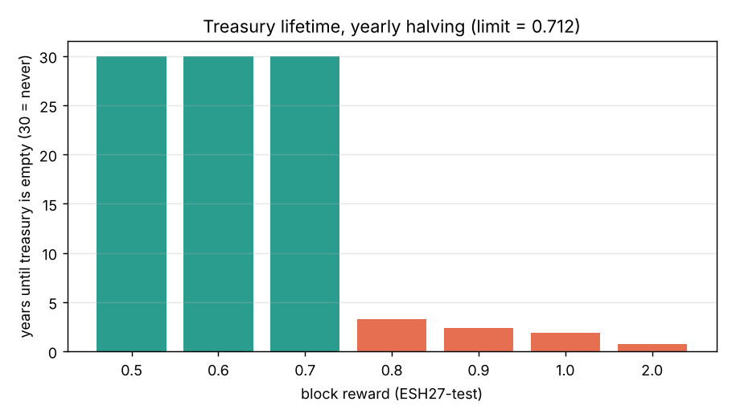
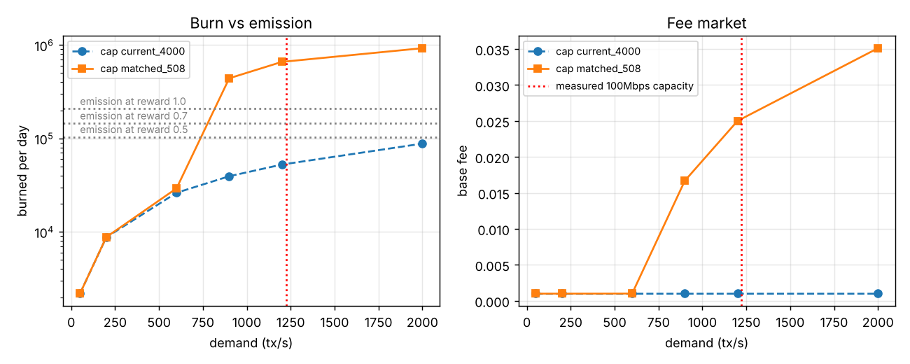
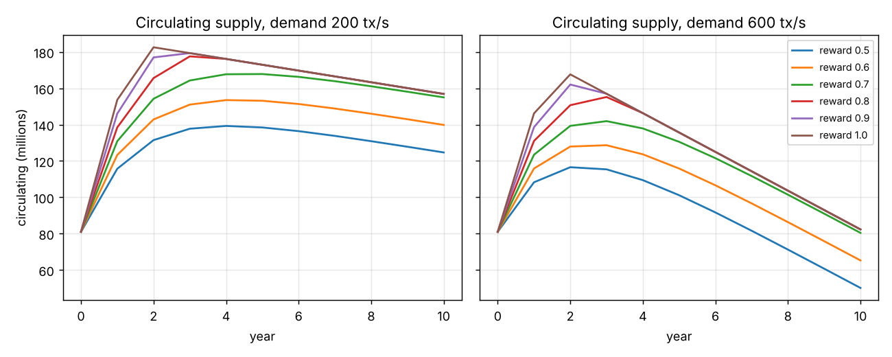

# ניסוי 01: כלכלת המטבע ESH27-test

נוצר על ידי `exp_coin.py`. הנחות שנלקחו מניסויי הקונצנזוס: בלוק כל 0.416 שניות (75.9 מיליון בלוקים בשנה), ותקרת רשת של כ-1,223 עסקאות בשנייה ב-100Mbps. באוצר 108 מיליון מטבעות. במחזור בתחילת הדרך: 81 מיליון (משתמשים וסטייק של מאמתים). חצייה של התגמול פעם בשנה.

## חלק א: רגישות לתגמול הבלוק

**השערה:** יש תגמול מקסימלי שמתחתיו האוצר לא מתרוקן לעולם. לפי חשבון, עם חצייה שנתית סך כל ההנפקה הוא פעמיים ההנפקה של השנה הראשונה, ולכן התגמול המקסימלי הוא 108M חלקי (2 × בלוקים בשנה) = 0.712.

**הרצה:** חישוב מדויק של לוח ההנפקה לכל תגמול.

**תוצאה:**

| תגמול לבלוק | הנפקה בשנה 1 (מיליון) | אינפלציה בשנה 1 | האוצר מתרוקן אחרי | סך הנפקה (מיליון) |
|---|---|---|---|---|
| 0.5 | 37.9 | 47% | לעולם לא | 75.9 |
| 0.6 | 45.5 | 56% | לעולם לא | 91.0 |
| 0.7 | 53.1 | 66% | לעולם לא | 106.2 |
| 0.8 | 60.7 | 75% | 3.2 שנים | 108.0 |
| 0.9 | 68.3 | 84% | 2.3 שנים | 108.0 |
| 1.0 | 75.9 | 94% | 1.8 שנים | 108.0 |
| 2.0 | 151.7 | 187% | 0.7 שנים | 108.0 |

**מסקנה:** ההשערה אושרה. 0.5, 0.6 ו-0.7 מחזיקים לנצח. 0.8 ומעלה מרוקנים את האוצר. אבל גם 0.7 נותן אינפלציה של 66% בשנה הראשונה, כי במחזור יש רק 81 מיליון. עם 0.5 האינפלציה היא 47%. בכל המקרים היא נחצית כל שנה.

## חלק ב: שוק העמלות מול קיבולת הרשת

**השערה:** העמלה עולה רק כשהבלוקים יותר מחצי מלאים. עם תקרה של 4,000 עסקאות לבלוק, "חצי מלא" הוא כ-4,800 עסקאות בשנייה, הרבה מעל מה שהרשת מחזיקה (1,223). לכן העמלה תישאר תמיד ברצפה, והשריפה זניחה. תקרה שמותאמת לקיבולת (508 עסקאות לבלוק) תפעיל את שוק העמלות.

**הרצה:** הדמיית ספר החשבונות, 4,000 בלוקים לכל רמת ביקוש, עם שתי תקרות בלוק.

**תוצאה:**

| תקרת בלוק | ביקוש tx/s | נכנס tx/s | עמלה ממוצעת | נשרף ביום |
|---|---|---|---|---|
| current_4000 | 50 | 50 | 0.0010 | 2,185 |
| current_4000 | 200 | 200 | 0.0010 | 8,756 |
| current_4000 | 600 | 599 | 0.0010 | 26,223 |
| current_4000 | 900 | 899 | 0.0010 | 39,404 |
| current_4000 | 1200 | 1,198 | 0.0010 | 52,547 |
| current_4000 | 2000 | 1,999 | 0.0010 | 88,030 |
| matched_508 | 50 | 50 | 0.0010 | 2,185 |
| matched_508 | 200 | 200 | 0.0010 | 8,796 |
| matched_508 | 600 | 598 | 0.0010 | 29,229 |
| matched_508 | 900 | 612 | 0.0167 | 440,507 |
| matched_508 | 1200 | 612 | 0.0250 | 659,979 |
| matched_508 | 2000 | 613 | 0.0351 | 924,635 |

להשוואה, ההנפקה ביום: 103,921 בתגמול 0.5, 145,490 בתגמול 0.7, 207,843 בתגמול 1.0.

**מסקנה:** ההשערה אושרה. עם התקרה הנוכחית העמלה נשארת על הרצפה עד הקיבולת, והשריפה קטנה פי עשרות מההנפקה. עם תקרה מותאמת העמלה מתחילה לעלות סביב 611 עסקאות בשנייה, וב-1,200 השריפה מגיעה ל-659,979 ביום. מביקוש של 900 עסקאות בשנייה השריפה עוברת את ההנפקה בתגמול 0.7, והמטבע נעשה דפלציוני. המשמעות המעשית: תקרת הבלוק צריכה לנבוע מהקיבולת שנמדדה, אחרת מנגנון השריפה מה-Whitepaper פשוט לא עובד.

**ממצא לא צפוי:** בעומס, העמלה מזנקת פי 17 ויותר מהרצפה. ב-900 עסקאות בשנייה נשרפים 161 מיליון מטבעות בשנה, יותר מכל ההיצע שבמחזור (81 מיליון). זה לא יכול לקרות במציאות: המשתמשים פשוט ייגמר להם הכסף, או שמחיר המטבע יעלה והעמלה במטבעות תרד. המסקנה היא שיחידות העמלה (רצפה של 0.001, ותקרה בפועל סביב 0.05) גבוהות מדי ביחס להיצע. צריך לכייל אותן כך ששריפה שנתית בעומס מלא תהיה אחוזים בודדים מההיצע, למשל רצפה של 0.00001 עם תקרת עמלה.

## חלק ג: היצע במחזור לאורך 10 שנים

**השערה:** בכל תגמול בטווח, ההיצע במחזור עולה בשנים הראשונות, כי ההנפקה גבוהה והשריפה נמוכה. בביקוש גבוה, אחרי כמה חציות, השריפה עוברת את ההנפקה וההיצע מתחיל לרדת.

**הרצה:** לוח ההנפקה מחלק א, ושריפה שנתית מחלק ב (תקרה מותאמת), בביקוש קבוע של 200 ו-600 עסקאות בשנייה. לא הרצתי 900, כי שם השריפה עוברת את כל ההיצע תוך שנה (ראה הממצא בחלק ב), והתחזית מאבדת משמעות.

**תוצאה:**

| תגמול | ביקוש | שנה 1 (מיליון) | שנה 3 | שנה 5 | שנה 10 | שנת שיא |
|---|---|---|---|---|---|---|
| 0.5 | 200 | 115.7 | 137.7 | 138.4 | 124.7 | 4 |
| 0.5 | 600 | 108.3 | 115.4 | 101.1 | 50.1 | 2 |
| 0.6 | 200 | 123.3 | 151.0 | 153.1 | 139.8 | 4 |
| 0.6 | 600 | 115.8 | 128.7 | 115.8 | 65.3 | 3 |
| 0.7 | 200 | 130.9 | 164.3 | 167.8 | 155.0 | 5 |
| 0.7 | 600 | 123.4 | 141.9 | 130.5 | 80.4 | 3 |
| 0.8 | 200 | 138.5 | 177.6 | 172.9 | 156.9 | 3 |
| 0.8 | 600 | 131.0 | 155.2 | 135.7 | 82.3 | 3 |
| 0.9 | 200 | 146.1 | 179.4 | 172.9 | 156.9 | 3 |
| 0.9 | 600 | 138.6 | 157.0 | 135.7 | 82.3 | 2 |
| 1.0 | 200 | 153.7 | 179.4 | 172.9 | 156.9 | 2 |
| 1.0 | 600 | 146.2 | 157.0 | 135.7 | 82.3 | 2 |

**מסקנה:** ההשערה אושרה. ההיצע במחזור עולה בשנים הראשונות, מגיע לשיא (בתגמול 0.7 ובביקוש 200: שנה 5, 168 מיליון), ואז יורד לאט, כשההנפקה הנחצית נופלת מתחת לשריפה. גם בעומס בלי שוק עמלות פעיל (העמלה ברצפה), השריפה מגיעה בסוף לגובה ההנפקה, כי ההנפקה נחצית כל שנה. תגמול 0.8 ומעלה נותן שיא גבוה יותר ומוקדם יותר, ואחר כך זהה לכולם, כי האוצר כבר ריק.

## חלק ד: מימון קרן הצדקה

**השערה:** בעומס נמוך, 10% מהעמלות לא מספיקים לקרן. 5% מתגמול הבלוק נותנים לה הכנסה יציבה, שלא תלויה בעומס.

**הרצה:** תגמול 0.7, תקרה מותאמת, עם ובלי 5% מהתגמול לקרן.

**תוצאה:**

| נתח מהתגמול | ביקוש tx/s | לקרן ביום |
|---|---|---|
| 0% | 50 | 437 |
| 0% | 200 | 1,759 |
| 0% | 600 | 5,846 |
| 5% | 50 | 7,711 |
| 5% | 200 | 9,034 |
| 5% | 600 | 13,120 |

**מסקנה:** ההשערה אושרה. בביקוש של 50 עסקאות בשנייה הקרן מקבלת 437 ביום מעמלות בלבד, ו-7,711 ביום עם 5% מהתגמול. ההכנסה מהתגמול יורדת בחצי כל שנה, יחד עם התגמול עצמו.

## המלצה למסמך הכלכלי

- תגמול בלוק של 0.5 עד 0.7. מעל 0.71 האוצר מתרוקן.
- תקרת בלוק לפי הקיבולת שנמדדה (כ-508 עסקאות לבלוק ב-100Mbps), כדי ששוק העמלות והשריפה יעבדו.
- 5% מתגמול הבלוק לקרן הצדקה, בנוסף ל-10% מהעמלות.
- לכייל את יחידות העמלה להיצע: רצפה נמוכה בהרבה ותקרת עמלה, כך ששריפה בעומס מלא תהיה אחוזים בודדים מההיצע בשנה.
- לא לכתוב "דפלציוני" במסמך. ההיצע במחזור עולה כמה שנים לפני שהוא מתחיל לרדת, וכמה מהר תלוי בביקוש.

## מגבלות

- הביקוש קבוע ולא גדל עם הזמן. במציאות הוא יגדל או יקרוס, וזה המשתנה החשוב ביותר.
- אין מחיר למטבע. כל המספרים ביחידות מטבע, לא בשקלים.
- התחזית ל-10 שנים מניחה שהרשת, התקרה וזמן הבלוק לא משתנים.
