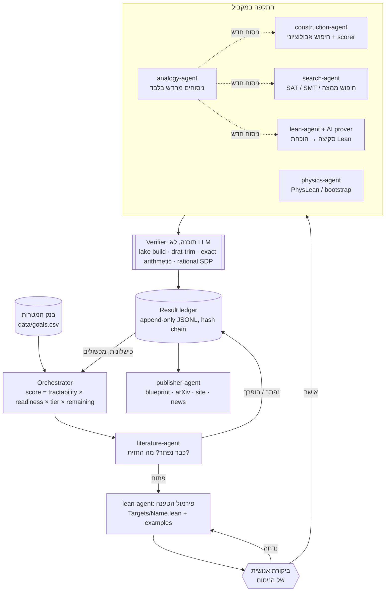

# פרק 6: ארכיטקטורת המעבדה

הפרק הרביעי הסתיים בלקח אחד: אימות גובר על יצירה. הפרק החמישי לימד את הכלי שמבצע את האימות. הפרק הזה מראה איך שני הדברים האלה הופכים למערכת עבודה: איך המעבדה בוחרת בעיה, מי עובד עליה, מי מחליט אם משהו נכון, ואיך כל ניסיון, מוצלח או כושל, נרשם כך שאי אפשר לשכתב אותו בדיעבד. הארכיטקטורה הזו היא מה שמבדיל מעבדה שמשתמשת ב-AI ממכונה לייצור הייפ. היא בנויה סביב הפרדה פשוטה: מי שמייצר רעיונות אינו מי שמאשר אמת. כל השאר נגזר מההפרדה הזו.

הפרק מבוסס על `docs/architecture.md` ועל הקוד שבתיקייה `orchestrator/`, ומתאר את מה שקיים במאגר נכון ל-4 בנובמבר 2026. איפה שהתיאור מתכנן משהו שעוד לא מומש בקוד, הדבר נאמר במפורש.

## העיקרון: גרעין אמון

במעבדה יש שלוש שכבות, ולכל אחת מעמד אחר:

| שכבה | מה היא כוללת | האם סומכים עליה? |
|---|---|---|
| **מחוללים (generators)** | מודלי שפה, חיפוש אבולוציוני, ה-analogy-agent, בני אדם בסיעור מוחות | **לא.** כל פלט הוא השערה עד שהוכח אחרת |
| **גרעין אמון (trust kernel)** | ה-kernel של Lean 4 (עם mathlib), ותעודות חישוב רפרודוקטיביות: הוכחות DRAT/LRAT לתוצאות SAT (נבדקות ב-`drat-trim` או ב-`cake_lpr`), אריתמטיקה מדויקת (שלמים ורציונליים) לבדיקת בניות, ותעודות SDP רציונליות לחסמי bootstrap | **כן.** זה הדבר היחיד שמעלה טענה לרמה L3 |
| **ביקורת אנושית** | אישור ניסוח הטענה, ביקורת עמיתים, החלטה על פרסום | נדרשת בשתי נקודות: לפני ההוכחה ולפני הפרסום |

הכלל, בניסוח של המסמך: **מודל שפה אף פעם לא "מוכיח". הוא מציע; ה-kernel מכריע.**

למה דווקא ה-kernel של Lean? כי הוא קטן, פשוט יחסית, ונבדק על ידי קהילה גדולה לאורך שנים. כשמשהו עובר `lake build` בלי `sorry` ובלי אקסיומות חדשות, הוא נכון. אבל, כפי שראינו בפרק 5, הוא נכון **ביחס לניסוח**. לכן גרעין האמון לבדו לא מספיק, ולכן יש שכבה שלישית.

> **אופן הכישלון מס' 1: לפרמל את הטענה הלא נכונה.** הוכחה מושלמת של ניסוח שגוי חסרת ערך, ואף מזיקה, כי היא נראית מאומתת. לכן ניסוח כל יעד עובר ביקורת אנושית לפני שמשקיעים בו מאמץ הוכחה, וכל קובץ יעד כולל דוגמאות שבודקות את הניסוח על מקרים קטנים.

כדאי לשים לב לסימטריה. גם התעודות שאינן Lean בנויות באותו היגיון: פותר SAT הוא תוכנה מסובכת שאולי יש בה באגים, אבל הוכחת DRAT שהוא מפיק נבדקת על ידי תוכנה קטנה ופשוטה, ו-`cake_lpr` אף אומת פורמלית בעצמו. אופטימייזר נומרי מוצא פתרון בנקודה צפה, אבל בודק בחשבון רציונלי מדויק מאשר אותו. בכל המקרים, החיפוש יכול להיות מסובך ולא אמין, והבדיקה פשוטה ואמינה.

## הלולאה

כך נראית העבודה על מטרה אחת, מבחירתה ועד פרסומה:



התרשים מופיע גם ב-`docs/architecture.md`, יחד עם גרסת ASCII לטרמינל. הנה השלבים, אחד אחד.

**1. בחירת יעד.** ה-orchestrator קורא את בנק המטרות ומדרג את המטרות הפתוחות לפי נוסחה שמשלבת את הסיכוי שכלי AI יתקדמו, את המוכנות של mathlib, את השכבה (tier) של המטרה, ואת העבודה שנשארה. את הנוסחה המדויקת נפרק בפרק 7.

**2. ספרות.** הסוכן הראשון שנוגע בכל מטרה הוא תמיד ה-literature-agent, והשאלה הראשונה שלו תמיד זהה: האם זה כבר נפתר או הופרך? זה הלקח הישיר של פרשת ארדש (פרק 4). הוא גם ממפה את החסמים הטובים ביותר הידועים, בודק מה כבר קיים ב-mathlib, ב-PhysLean וב-Formal Conjectures, ומסמן עמימויות בניסוח. אם המטרה נפתרה, היא הולכת ישר ליומן.

**3. פירמול.** ה-lean-agent כותב את הטענה כ-`def Name : Prop` בתיקייה `lean/EshLab/Targets/`, יחד עם דוגמאות שפיות ותרגום חזרה לשפה טבעית. כאן נמצאת **נקודת הביקורת האנושית הראשונה**: אף אחד לא מתחיל להוכיח לפני שאדם אישר שהניסוח אומר את מה שצריך.

**4. התקפה במקביל.** כמה סוכנים עובדים על המטרה בו-זמנית, כל אחד בשיטה אחרת:
- *בנייה:* מודל שפה מציע תוכניות שמייצרות אובייקטים, ו-scorer דטרמיניסטי וקפוא מעריך אותן, בסגנון FunSearch ו-AlphaEvolve.
- *SAT/SMT:* קידוד מקרים סופיים לנוסחה. תשובה "אין פתרון" (UNSAT) חייבת להגיע עם הוכחת DRAT או LRAT.
- *הוכחה:* סקיצה לא-פורמלית (L2) הופכת להוכחת Lean בעזרת מוכיח AI, עם למות ביניים מאורגנות כ-blueprint.
- *פיזיקה:* ניסוח מדויק וחסמי bootstrap עם תעודה רציונלית.
- *אנלוגיה:* ניסוחים מחדש שמועברים לסוכנים האחרים לבדיקה.

**5. אימות.** ה-verifier הוא תוכנה דטרמיניסטית, לא מודל שפה, והיא היחידה שרשאית לסמן `certificate.verified = true`. נכון לכתיבת הפרק, ה-verifier מתואר במסמכים ומופיע כשלב בתוכנית ההתקפה, אבל עוד לא מומש כמודול נפרד בקוד. האכיפה שקיימת כבר היום היא בצד היומן: `ledger.validate()` מסרב לרשום טענה ברמה L3 ומעלה בלי תעודה שמסומנת כמאומתת.

**6. יומן.** כל ניסיון נרשם, בין שהצליח ובין שנכשל.

**7. פרסום.** ה-publisher-agent הופך רשומות מאומתות ל-blueprint, לטיוטת arXiv, לעדכון באתר ולכתבה ב-S27 News, תמיד עם תג של רמת הטענה וקישור לתעודה. כאן נמצאת **נקודת הביקורת האנושית השנייה**.

והחץ האחרון בתרשים חשוב לא פחות: כישלונות ומכשולים חוזרים מהיומן אל ה-orchestrator. ניסיון שנכשל הוא מידע שמשפיע על הבחירה הבאה, ומשמש את ה-analogy-agent כחומר גלם.

## רמות טענה

כל טענה במעבדה נושאת רמה, מ-L0 עד L4. זה אולי הרעיון הפשוט והחשוב ביותר בארכיטקטורה, כי הוא מאפשר לדבר בכנות על התקדמות חלקית.

| רמה | שם | מה נדרש | מי רשאי לקבוע |
|---|---|---|---|
| **L0** | רעיון / השערה | ניסוח ברור | כל סוכן (ה-analogy-agent תמיד כאן) |
| **L1** | ראיה נומרית | סקריפט רפרודוקטיבי, גרסאות, seeds | search, construction, physics |
| **L2** | הוכחה לא-פורמלית | טקסט מתמטי מלא שנבדק על ידי סוכן שני | lean-agent, אדם |
| **L3** | מאומת מכונה | `lake build` נקי, או DRAT שנבדק, או בדיקה מדויקת; אקסיומות רק מתוך {propext, Classical.choice, Quot.sound}; הוכחה של היעד **שאושר** | **רק ה-verifier** |
| **L4** | פורסם / ביקורת עמיתים | מאמר שהתקבל, או אימוץ בקהילה (למשל מיזוג ל-mathlib) | אדם |

בקוד, הרמות מוגדרות כ-`ClaimLevel` ב-`orchestrator/ledger.py`: `L0_IDEA`, `L1_NUMERIC`, `L2_INFORMAL`, `L3_LEAN_VERIFIED`, `L4_PUBLISHED`. ה-README הראשי של המעבדה מוסיף לכל רמה את מה שמותר לומר עליה בפומבי: "יש לנו כיוון" (L0), "בדקנו עד N" (L1), "יש טיוטת הוכחה" (L2), "הוכח, מאומת מכונה" (L3), "פורסם" (L4).

נקודה עדינה: L3 על **חלק** מבעיה, כמו חסם משופר או מקרה פרטי, הוא תוצאה לגיטימית ויקרה. האתר מציג אותה בדיוק כך, ולא כ"נפתר". ה-publisher-agent מונחה במפורש לכתוב "Lean-verified improved lower bound", ולא "solved".

## סגל הסוכנים

המעבדה מגדירה שבעה סוכנים ותוכנה אחת. לכל סוכן יש מפרט קריא לבני אדם בתיקייה `agents/<name>.md`, וגרסה כנתונים (כולל ה-system prompt) ב-`orchestrator/agents.py`. לכל סוכן מוגדרת גם **הרמה המקסימלית שמותר לו לטעון בעצמו** (`max_self_claim`).

| סוכן | משימה | כלים עיקריים | רמה מקסימלית |
|---|---|---|---|
| **literature-agent** | להכריע אם המטרה כבר נפתרה, ולמפות את החזית | arXiv, zbMATH, MathSciNet, OEIS, חיפוש ב-mathlib | L1 |
| **lean-agent** | לפרמל ניסוחים בנאמנות ולחפש הוכחות Lean | `lake build`, Lean REPL/LSP, מוכיח AI, Loogle, `exact?` | L2 (L3 רק דרך ה-verifier) |
| **search-agent** | דוגמאות נגדיות, מקרים קטנים ותעודות בחיפוש ממצה, SAT ו-SMT | CaDiCaL, Kissat, drat-trim, cake_lpr, Z3, cvc5 | L1 |
| **construction-agent** | לבנות אובייקטים מפורשים שמשפרים חסמים | לולאה אבולוציונית מונחית-LLM, חשבון מדויק | L1 |
| **physics-agent** | להפוך בעיות פיזיקה לטענות מדויקות ולחסמים עם תעודה | PhysLean, SDPB, CAS | L1 |
| **analogy-agent** | לייצר ניסוחים מחדש ואנלוגיות כזוויות התקפה | המודל בלבד | **L0 תמיד** |
| **publisher-agent** | להפוך רשומות מאומתות לפרסום | leanblueprint, LaTeX, מחולל האתר | L0 (משקף את היומן בלבד) |
| **verifier** (תוכנה) | לבדוק תעודות | lake, drat-trim, בודקים מדויקים | **היחיד שקובע L3** |

לכל הסוכנים יש פסקה משותפת של "כללי יושר" (הקבוע `HONESTY` בקוד), שמצורפת לכל system prompt. בתמצית: אתה מחולל לא אמין; אל תטען שמשהו הוכח בלי תעודה מאומתת; סמן כל טענה ברמה; צטט עם מזהים (arXiv, DOI, שם ב-mathlib), ואם אינך בטוח שמקור קיים, אמור זאת; עדיף "אני לא יודע" מהמצאה; כישלונות נרשמים ביומן.

כמה מהמפרטים כוללים כללים מיוחדים שכדאי להכיר:

- **ה-lean-agent** מוזהר ש"פירמול הטענה הלא נכונה הוא אופן הכישלון מס' 1", ונדרש לכתוב דוגמאות למקרים נכונים **וגם** למקרים שאמורים להיכשל, ולהוכיח את היעד שאושר ולא עותק שלו.
- **ה-construction-agent** עובד עם scorer שמוקפא לפני תחילת החיפוש ונבדק בנפרד, ובודק שיאים שנכתב בנפרד מהמחולל. "ציון בנקודה צפה אינו ראיה לשיא." וגם: "לעולם אל תכוונן את ה-scorer למועמד". זה הלקח של Georgiev ושותפיו על מערכות שמנצלות באגים במעריך.
- **ה-analogy-agent** הוא "מחולל ניסוחים בלבד, לעולם לא מקור לאמת". נחזור אליו בהמשך.
- **ה-publisher-agent** מפרסם רק את מה שהיומן תומך בו, ברמה המדויקת שהיומן רושם. הסתייגויות ותיקונים מתפרסמים באותה בולטות כמו הטענות.

### איך נבנית תוכנית התקפה

הפונקציה `plan_for` ב-`orchestrator/agents.py` מחליטה אילו סוכנים ירוצו על מטרה נתונה. הלוגיקה פשוטה: תמיד מתחילים ב-literature-agent (שלב triage) וב-lean-agent (שלב פירמול). בשלב ההתקפה המקבילי נכנס קודם הסוכן האחראי על המטרה (`owner_agent`), אם הוא לא אחד משני הראשונים; אם התחום כולל פיזיקה, נכנס ה-physics-agent; אחר כך משלימים מתוך construction, search ו-lean עד שלושה סוכנים; ותמיד מוסיפים את ה-analogy-agent. בסוף, ה-verifier וה-publisher-agent.

## היומן

היומן (ledger) הוא הזיכרון של המעבדה, והוא בנוי כך שיהיה קשה לשקר בו. הקוד נמצא ב-`orchestrator/ledger.py`, והקובץ הוא `data/ledger.jsonl` (הוא נוצר בריצה האמיתית הראשונה, ונכון לכתיבת הפרק עוד לא קיים במאגר).

שלוש תכונות מגדירות אותו:

**Append-only.** כל ניסיון הוא שורת JSON אחת, ושורות אף פעם לא נערכות. תיקון הוא רשומה חדשה, עם שדה `supersedes` שמצביע על `attempt_id` של הרשומה הישנה. ההיסטוריה נשארת גלויה.

**שרשרת hash.** כל רשומה כוללת את ה-SHA-256 של השורה הקודמת, בשדה `prev_sha256`. אם מישהו ישנה רשומה ישנה בשקט, השרשרת תישבר. הפונקציה `verify_chain()` בודקת את זה, והפקודה `python -m orchestrator.run --ledger-check` מריצה אותה.

**אכיפת יושר.** הפונקציה `validate()` נקראת לפני כל הוספה, ומסרבת לרשום טענה ברמה L3 ומעלה אם אין לה תעודה עם `verified: true` ועם סוג מוגדר (`lean`, `drat`, `exact-arith` וכן הלאה). כלומר, גם אם סוכן "מתבלבל" ומנסה לרשום L3, הקוד לא יאפשר זאת.

ומה קורה כשסוכן באמת רץ? בפקודה `--run`, הפלט של המודל נרשם ביומן תמיד ברמה **L0**, עם `outcome: "pending"`. ההערה בקוד אומרת זאת במפורש: פלט גולמי של מודל שפה לעולם אינו מעל L0 עד שנבדק.

הרמה של מטרה כולה נגזרת מהיומן: `best_level()` מחזירה את הרמה המקסימלית על פני ניסיונות שאינם ריצת ניסיון (`dry_run`). לפי `docs/architecture.md`, גם ניסיונות שהוחלפו (`supersedes`) אמורים להיות מוחרגים מהחישוב. בקוד הנוכחי, `best_level()` מסננת רק את ריצות הניסיון, וזה פער שכדאי לסגור.

## מודל הנתונים

`docs/architecture.md` מגדיר ארבע ישויות:

```text
Goal         (data/goals.csv — מקור האמת לבנק המטרות)
  id, title, title_he, field, tier, status, statement_short, why_it_matters,
  ai_tractability, formalization_readiness, known_partial_results,
  suggested_attack, references, owner_agent, progress_pct, last_update
  + (נגזר) lean_target, statement_reviewed_by, statement_reviewed_at

Attempt      (שורה ב-data/ledger.jsonl)
  attempt_id, goal_id, agent, method, claim_level (0–4), outcome
  (pending|success|partial|failed|refuted), summary, artifacts[], certificate?,
  model, dry_run, supersedes?, timestamp, prev_sha256

Artifact     (קובץ תחת artifacts/<goal_id>/<attempt_id>/)
  path, sha256, kind (lean | cnf | drat | construction | script | notebook | report),
  produced_by (agent + model + version)

Certificate  (מצורף ל-Attempt)
  kind (lean | drat | lrat | exact-arith | sdp-rational | none),
  path, checker, checker_version, sha256, verified
  + עבור lean: lean-toolchain, hash של lake-manifest.json, פלט #print axioms
```

היחסים: למטרה יש הרבה ניסיונות, לניסיון יש הרבה תוצרים (artifacts), ולניסיון יש לכל היותר תעודה אחת. שימו לב לשדות של תעודת Lean: גרסת ה-toolchain וה-hash של `lake-manifest.json`. זה הקשר לנעילת הגרסאות שראינו בפרק 5. בלי גרסה נעולה, אי אפשר לשחזר את הבדיקה, ולכן אין תעודה.

בקוד הנוכחי מומשו `Attempt` ו-`Certificate` כ-dataclasses ב-`ledger.py`. השדות הנגזרים של Goal (כמו `statement_reviewed_by`) ותיקיית `artifacts/` הם עדיין תכנון.

## ה-orchestrator בשימוש

ה-orchestrator הוא תוכנית פייתון קטנה, שכתובה בספרייה הסטנדרטית בלבד. ה-SDK של Anthropic נטען רק כשמבצעים קריאה אמיתית למודל. כך מריצים אותו, מתוך התיקייה `lab/`:

```bash
python -m orchestrator.run --list                  # דירוג כל המטרות הפתוחות
python -m orchestrator.run --next                  # המטרה הבאה
python -m orchestrator.run --dry-run G050          # תוכנית התקפה, בלי קריאות API
python -m orchestrator.run --dry-run G050 --prompts   # כולל הפרומפטים לכל סוכן
python -m orchestrator.run --ledger-check          # בדיקת שלמות שרשרת ה-hash
ESH_MODEL=claude-opus-5-5 python -m orchestrator.run --run G050 --agent literature-agent
```

הפקודה האחרונה דורשת משתנה סביבה `ANTHROPIC_API_KEY`. בלעדיו היא מסרבת ומפנה ל-`--dry-run`.

כך נראה הפלט של `--next` על בנק המטרות הנוכחי (הורץ בזמן כתיבת הפרק):

```text
NEXT: G024 - Formal-conjectures contributions
  score=1.100 (tractability=1.00, readiness=1.00, progress=0%, tier=C-Tractable)
  owner: lean-agent   field: formalization / all fields
```

וכך נראה `--dry-run G050`, המטרה הראשונה מבין שלוש מטרות הפתיחה של המעבדה (פרק 7):

```text
DRY RUN for G050: Small Ramsey-type numbers in Lean via SAT certificates (S(4)=44, W(3,3)=27, W(2,4)=35)
model: claude-opus-5-5  (no API calls will be made)
ledger: 0 prior attempts, best level none

[1-triage] literature-agent  (may self-claim <= L1)
[2-formalize] lean-agent  (may self-claim <= L2)
[3-attack (parallel)] construction-agent  (may self-claim <= L1)
[3-attack (parallel)] search-agent  (may self-claim <= L1)
[3-attack (parallel)] lean-agent  (may self-claim <= L2)
[3-attack (parallel)] analogy-agent  (may self-claim <= L0)
[4-verify] verifier (program, not LLM): lake build / drat-trim / exact-arith -> L3
[5-publish] publisher-agent  (may self-claim <= L0)

Nothing was written. Use --run GOAL --agent NAME for a real call.
```

(הפלט קוצר: בפלט המלא מופיעה מתחת לכל סוכן גם רשימת הכלים שלו.)

כדאי לשים לב שבמקרה של G050 הסוכן האחראי הוא ה-lean-agent עצמו, ולכן שלב ההתקפה מתמלא בסוכני ברירת המחדל: construction, search ו-lean.

ההגדרות נקבעות במשתני סביבה, בלי סודות בקוד (`orchestrator/config.py`): `ESH_MODEL` (ברירת המחדל `claude-opus-5-5`), `ESH_GOALS` (נתיב לבנק המטרות), `ESH_LEDGER` (נתיב ליומן), `ESH_LEAN_ROOT` (נתיב לפרויקט Lean) ו-`ESH_MAX_TOKENS` (ברירת המחדל 8000). לבדיקות יש קובץ מטרות קטן ב-`tests/fixture_goals.csv`.

## איך הפיזיקה משתלבת

פיזיקה תיאורטית מציבה אתגר מיוחד, כי בעיה בפיזיקה היא לרוב לא "טענה" אחת, אלא משפחה של הנחות: יוניטריות, סימטריית crossing, פערים בספקטרום, קיטוע. לכן ה-physics-agent פועל לפי כמה כללים:

- **ניסוח קודם לכל.** הוא כותב ניסוח מתמטי מדויק עם רשימת הנחות מפורשת, ומפריד בין החלק הריגורוזי לבין ההיוריסטיקה הפיזיקלית.
- **PhysLean.** כשקיימות הגדרות בספריית PhysLean (ספריית Lean לפיזיקה, לשעבר HepLean), משתמשים בהן, ומדווחים על הגדרות חסרות כמשימות פירמול.
- **חסמי bootstrap כתעודות.** חסם conformal bootstrap הוא בעיית תכנות חצי-מוגדר (SDP). פתרון נומרי בתוכנה כמו SDPB הוא **L1** בלבד. כדי להפוך אותו לתעודה, מעגלים את הפתרון הדואלי למספרים רציונליים ובודקים באריתמטיקה מדויקת את החיוביות. זו תעודה שניתן לבדוק באופן עצמאי (`certificate.kind = "sdp-rational"`), ובטווח הארוך אפשר לייבא אותה ל-Lean.

הדוגמה שהמסמך נותן: חסמים ריגורוזיים על ממדי סקלינג במודל Ising התלת-ממדי, בהינתן הנחות מפורשות. זו המטרה G068 בבנק.

## ה-analogy-agent: מחולל ניסוחים בלבד

ESH27 Lab שואבת השראה גם ממקורות לא-מתמטיים: גמרא, קבלה וחוכמות עתיקות. ה-analogy-agent הוא המקום שבו ההשראה הזו פוגשת את העבודה, והוא מוגדר בזהירות רבה, דווקא כדי שהיא לא תפגע באמינות.

התפקיד שלו הוא אך ורק לייצר זוויות תקיפה חדשות. כמה דוגמאות לתרגום, מתוך המפרט:

- **קל וחומר** ← למת מונוטוניות ("אם זה נכון למקרה הקשה, זה נכון לקל").
- **בניין אב** ← אינדוקציה ממקרה-אב, או דוגמה קיצונית.
- **גזירה שווה** ← איזומורפיזם בין שני מבנים שנראים שונים.
- **הספירות** ← חיפוש מבנה מדורג או מסונן, ואינווריאנטים לאורכו.

ושלושה כללים:

1. כל אנלוגיה **חייבת** להיות מתורגמת לטענה מתמטית מדויקת שאפשר לבדוק, ולהיות מועברת לסוכן שיבדוק אותה (search, construction או lean). אנלוגיה שאי אפשר לתרגם נזרקת.
2. כל פלט שלו הוא **L0**. הוא לעולם אינו מקור לאמת. מסורת, גימטריה או סמליות אינן ראיה לטענה מתמטית.
3. מודדים פוריות: היומן רושם אילו ניסוחים מחדש הובילו לתוצאות L1 ומעלה, כדי ללמוד אילו סוגי אנלוגיות מועילים בפועל.

הכלל השלישי הופך שאלה שבדרך כלל היא עניין של טעם ("האם הגישה הזו מועילה?") לשאלה אמפירית שאפשר לענות עליה מתוך נתונים.

## מבנה המאגר

החלק של המאגר שרלוונטי לארכיטקטורה נראה כך:

```text
lab/
├── data/goals.csv            # בנק המטרות
├── data/ledger.jsonl         # יומן התוצאות (נוצר בריצה הראשונה)
├── lean/                     # פרויקט Lake בשם EshLab: גרעין האמון
│   ├── lakefile.toml, lean-toolchain
│   ├── EshLab/Basic.lean     # משפטי חימום מוכחים
│   └── EshLab/Targets/       # בעיות פתוחות כ-Prop, בלי sorry
├── orchestrator/             # Python stdlib (+ anthropic SDK אופציונלי)
│   ├── goals.py  ledger.py  agents.py  config.py  run.py
├── agents/*.md               # מפרטי תפקידים
└── tests/fixture_goals.csv
```

בעתיד תתווסף התיקייה `lean/EshLab/Solved/`, עם קובץ הוכחה אחד לכל מטרה (`G0xx_*.lean`), ותיקיית `artifacts/` לתוצרים.

## עקרונות היושר, בסיכום

המסמך מסכם את הארכיטקטורה בחמישה עקרונות, וכדאי לחזור עליהם כלשונם:

1. מודל שפה הוא מחולל לא אמין. Lean, DRAT ואריתמטיקה מדויקת הם גרעין האמון.
2. ניסוח הטענה נבדק על ידי אדם לפני כל מאמץ הוכחה.
3. כל טענה נושאת רמה (L0–L4), וכל טענה ציבורית מקושרת לתעודה.
4. כישלונות נרשמים. ההיסטוריה ביומן אינה נמחקת.
5. גרסאות מוצמדות (lean-toolchain, lake-manifest, גרסאות של פותרים). אחרת אין רפרודוקטיביות, ואין תעודה.

## בקצרה

- הארכיטקטורה מפרידה בין מחוללים לא אמינים (מודלי שפה, חיפוש, בני אדם בסיעור מוחות) לבין גרעין אמון (Lean, DRAT/LRAT, חשבון מדויק, SDP רציונלי).
- הלולאה: בחירת יעד, ספרות, פירמול, ביקורת אנושית, התקפה מקבילה, אימות, יומן, פרסום. כישלונות חוזרים לבחירה.
- רמות טענה L0–L4. רק ה-verifier קובע L3, ולכל סוכן יש תקרה של מה שמותר לו לטעון.
- היומן הוא append-only, עם שרשרת hash ואכיפה בקוד: אין L3 בלי תעודה מאומתת, ופלט גולמי של מודל נרשם תמיד כ-L0.
- ה-orchestrator הוא CLI קטן: `--list`, `--next`, `--dry-run`, `--run`, `--ledger-check`.
- חלקים מהארכיטקטורה עדיין בתכנון: verifier כמודול, תיקיית `artifacts/`, החרגת רשומות שהוחלפו מחישוב הרמה.

## רעיונות לתוכן

1. **"מי מחליט מה נכון?": מדריך חזותי לגרעין האמון.** זווית: אינפוגרפיקה של שלוש השכבות, עם דוגמה של טענה אחת שעוברת מ-L0 ל-L3. קהל יעד: הקהל הרחב של S27 News.
2. **סרטון: "יומן שאי אפשר לשקר בו".** זווית: הסבר על append-only ושרשרת hash, והשוואה לפנקס מעבדה במדעי הניסוי. קהל יעד: אנשי טכנולוגיה וחובבי מדע.
3. **פוסט טכני: "בנינו orchestrator בכ-600 שורות פייתון".** זווית: סיור בקוד, עם הפלט האמיתי של `--dry-run`. קהל יעד: מפתחים שבונים מערכות סוכנים.
4. **"מקל וחומר ללמת מונוטוניות": ה-analogy-agent.** זווית: איך מסורת לימוד יהודית הופכת לכלי חשיבה, בלי להפוך לטיעון. קהל יעד: קוראים דתיים ומסורתיים עם עניין במדע.
5. **דף באתר: "מה פירוש L3?".** זווית: מילון קצר לרמות הטענה, שאליו מקשרת כל כתבה. קהל יעד: כל קוראי האתר.
