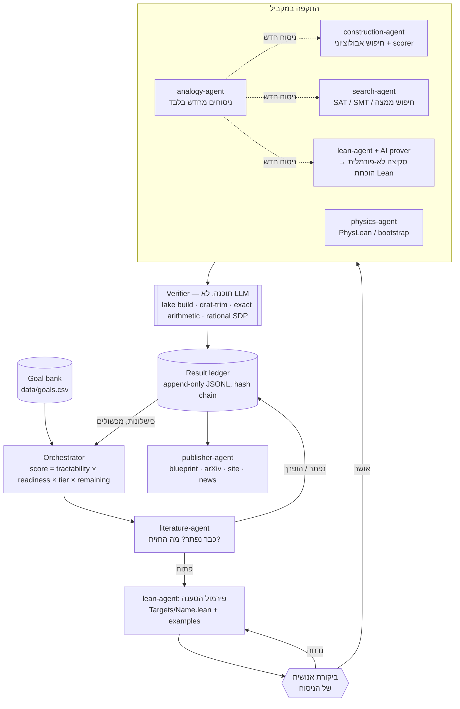

# ארכיטקטורה — ESH27 Lab: מעבדה הבנויה על שפת ההוכחות הפורמליות

> עודכן: 2026-11-04 · קבצים קשורים: `lean/`, `orchestrator/`, `agents/`, `data/goals.csv`

## 1. העיקרון המרכזי: גרעין אמון (trust kernel)

המעבדה מפרידה בין **מי שמייצר רעיונות** לבין **מי שמאשר אמת**.

| שכבה | מה היא | האם סומכים עליה? |
|---|---|---|
| **מחוללים (generators)** | מודלי שפה (LLMs), חיפוש אבולוציוני, analogy-agent, בני אדם בסיעור מוחות | **לא.** כל פלט הוא השערה עד שהוכח אחרת |
| **גרעין אמון (trust kernel)** | ה-kernel של **Lean 4** (+ Mathlib), ותעודות חישוב רפרודוקטיביות: **DRAT/LRAT** ל-SAT (נבדקות ב-`drat-trim` / `cake_lpr`), **אריתמטיקה מדויקת** (שלמים/רציונליים) לבדיקת קונסטרוקציות, **תעודות SDP רציונליות** לחסמי bootstrap | **כן** — זה הדבר היחיד שמעלה טענה לרמה L3 |
| **ביקורת אנושית** | אישור ניסוח הטענה (statement), ביקורת עמיתים, החלטה על פרסום | נדרשת בשתי נקודות קריטיות: לפני ההוכחה ולפני הפרסום |

הכלל: **מודל שפה אף פעם לא "מוכיח". הוא מציע; ה-kernel מכריע.**
ה-kernel של Lean קטן ונבדק היטב; מה שעובר `lake build` בלי `sorry` ובלי אקסיומות חדשות — נכון *ביחס לניסוח*. ולכן:

> **אופן הכישלון מס' 1: לפרמל את הטענה הלא נכונה.** הוכחה מושלמת של ניסוח שגוי היא חסרת ערך — ואף מזיקה, כי היא נראית מאומתת. לכן ניסוח כל target עובר **ביקורת אנושית** לפני שמשקיעים בו מאמץ הוכחה, וכל קובץ target כולל `example`ים שבודקים את הניסוח על מקרים קטנים (גם מקרים נכונים וגם מקרים שאמורים להיכשל).

## 2. הלולאה (The loop)



גרסת ASCII (לטרמינל):

```
 goals.csv ──► orchestrator ──► literature-agent ──(solved?)──► ledger
                                     │ open
                                     ▼
                         lean-agent: formalize statement
                                     │
                          [HUMAN REVIEW of statement]   ◄── failure mode #1
                                     │ approved
        ┌──────────────┬─────────────┼──────────────┬──────────────┐
        ▼              ▼             ▼              ▼              ▼
  construction     search (SAT)   informal→Lean   physics       analogy
  evo + scorer     DRAT/LRAT      AI prover       bootstrap     (L0 reformulations)
        └──────────────┴─────────────┼──────────────┴──────────────┘
                                     ▼
                VERIFIER (program): lake build | drat-trim | exact-arith
                                     ▼
                     LEDGER (append-only, claim levels L0–L4)
                                     ▼
                publisher: blueprint · arXiv · site · news
```

### שלבי הלולאה בפירוט

1. **בחירת יעד.** `python -m orchestrator.run --next` מדרג מטרות פתוחות לפי
   `ai_tractability × formalization_readiness × tier_weight × (1 − progress)`.
2. **ספרות (literature-agent).** השאלה הראשונה תמיד: האם זה כבר נפתר/הופרך? מה החסמים הטובים ביותר? מה כבר קיים ב-Mathlib / PhysLean / Formal Conjectures? מסמנים עמימויות בניסוח.
3. **פירמול (lean-agent).** כתיבת `def Name : Prop` ב-`lean/EshLab/Targets/`, עם `example`ים ותרגום-חזרה לשפה טבעית. **ביקורת אנושית חובה.**
4. **התקפה במקביל.**
   - *קונסטרוקציה:* LLM מציע תוכניות שמייצרות אובייקטים; scorer דטרמיניסטי וקפוא מעריך (בסגנון FunSearch/AlphaEvolve).
   - *SAT/SMT:* קידוד מקרים סופיים; UNSAT מלווה בהוכחת DRAT/LRAT.
   - *הוכחה:* סקיצה לא-פורמלית (L2) → הוכחת Lean עם AI prover, למות ביניים כ-blueprint.
   - *פיזיקה:* ניסוח מדויק + חסמי bootstrap עם תעודה רציונלית.
   - *אנלוגיה:* ניסוחים מחדש שמועברים לסוכנים האחרים לבדיקה.
5. **אימות (verifier).** תוכנה דטרמיניסטית בלבד; היא היחידה שרושמת `certificate.verified = true`.
6. **יומן תוצאות (ledger).** כל ניסיון — הצלחה או כישלון — נרשם ב-`data/ledger.jsonl`, append-only עם hash chain (`--ledger-check`). `ledger.validate()` דוחה כל טענת L3+ בלי תעודה מאומתת.
7. **פרסום.** blueprint (leanblueprint), טיוטת arXiv, עדכון האתר וחדשות — תמיד עם תג רמת הטענה וקישור לתעודה.

## 3. רמות טענה (Levels of claim)

| רמה | שם | מה נדרש | מי יכול לקבוע |
|---|---|---|---|
| **L0** | רעיון / השערה | ניסוח ברור | כל סוכן (analogy-agent תמיד כאן) |
| **L1** | ראיה נומרית | סקריפט רפרודוקטיבי, גרסאות, seeds | search / construction / physics |
| **L2** | הוכחה לא-פורמלית | טקסט מתמטי מלא שנבדק על ידי סוכן שני | lean-agent, אדם |
| **L3** | מאומת מכונה | `lake build` נקי / DRAT נבדק / בדיקה מדויקת; אקסיומות ⊆ {propext, Classical.choice, Quot.sound}; הוכחה של ה-target **שאושר** | **רק ה-verifier** |
| **L4** | פורסם / ביקורת עמיתים | מאמר מתקבל, או אימוץ ע"י הקהילה (למשל מיזוג ל-Mathlib) | אדם |

שימו לב: L3 על **חלק** מבעיה (חסם משופר, מקרה פרטי) הוא תוצאה לגיטימית ויקרה; האתר מציג אותה בדיוק כך — לא "נפתר".

## 4. מודל הנתונים

```text
Goal         (data/goals.csv — מקור האמת לבנק המטרות)
  id, title, title_he, field, tier, status, statement_short, why_it_matters,
  ai_tractability, formalization_readiness, known_partial_results,
  suggested_attack, references, owner_agent, progress_pct, last_update
  + (נגזר) lean_target: "EshLab.Targets.<Name>", statement_reviewed_by, statement_reviewed_at

Attempt      (שורה ב-data/ledger.jsonl — orchestrator/ledger.py)
  attempt_id, goal_id, agent, method, claim_level (0–4), outcome
  (pending|success|partial|failed|refuted), summary, artifacts[], certificate?,
  model, dry_run, supersedes?, timestamp, prev_sha256

Artifact     (קובץ תחת artifacts/<goal_id>/<attempt_id>/)
  path, sha256, kind (lean | cnf | drat | construction | script | notebook | report),
  produced_by (agent + model + version)

Certificate  (מצורף ל-Attempt)
  kind (lean | drat | lrat | exact-arith | sdp-rational | none),
  path, checker ("lake build", "drat-trim", "cake_lpr", …), checker_version,
  sha256, verified (bool — נקבע רק ע"י ה-verifier)
  + עבור lean: lean-toolchain, hash של lake-manifest.json, פלט #print axioms
```

יחסים: `Goal 1—* Attempt`, `Attempt 1—* Artifact`, `Attempt 0..1—1 Certificate`. רמת הטענה של מטרה = המקסימום על פני ניסיונות שאינם dry-run ולא הוחלפו (`supersedes`).

## 5. סגל הסוכנים (Agent roster)

מפרט מלא: `agents/<name>.md`; ה-system prompts כנתונים: `orchestrator/agents.py`.

| סוכן | קלט | פלט | כלים | רמה מקס' שמותר לו לטעון בעצמו |
|---|---|---|---|---|
| **literature-agent** | שורת goal, references, ledger | פסק דין (פתוח/נפתר/מעורפל), ביבליוגרפיה, טבלת חסמים, כיסוי Mathlib | arXiv, zbMATH, OEIS, Loogle | L1 |
| **lean-agent** | ניסוח, dossier, סקיצות | `Targets/*.lean`, `Solved/*.lean`, build log | Lean 4, Mathlib, lake, AI prover | L2 (L3 רק דרך verifier) |
| **search-agent** | טענה פורמלית, טווחים | קידודי CNF/SMT, פתרונות / UNSAT+DRAT | CaDiCaL, Kissat, drat-trim, Z3, cvc5 | L1 |
| **construction-agent** | פונקציית מטרה, שיא נוכחי | קונסטרוקציות + בודק מדויק | לולאה אבולוציונית מונחית-LLM, `fractions` | L1 |
| **physics-agent** | בעיה פיזיקלית, הנחות | ניסוח מדויק, PhysLean, חסמי SDP עם תעודה | PhysLean, SDPB, CAS | L1 |
| **analogy-agent** | ניסוח + מכשולים | 3–7 ניסוחים מחדש מתורגמים לשאלות מדויקות | המודל בלבד | **L0 תמיד** |
| **publisher-agent** | ledger, תעודות | blueprint, site, news, arXiv | leanblueprint, LaTeX | משקף את ה-ledger בלבד |
| **verifier** (תוכנה) | artifacts + certificate | `verified: true/false` | lake, drat-trim, בודקים מדויקים | **היחיד שקובע L3** |

## 6. איך הפיזיקה משתלבת

- **ניסוח קודם לכל.** בעיות בפיזיקה תאורטית לרוב אינן "טענה" אחת אלא משפחה של הנחות (יוניטריות, crossing, פערים בספקטרום, קיטוע). ה-physics-agent כותב ניסוח מתמטי מדויק עם רשימת הנחות מפורשת, ומבדיל בין החלק הריגורוזי להיוריסטיקה.
- **PhysLean.** משתמשים בהגדרות של PhysLean (ספריית Lean לפיזיקה) כשקיימות — אינדקס טנזורים, אלגברות לי, מכניקה קוונטית בסיסית — ומדווחים על הגדרות חסרות כמשימות פירמול.
- **חסמי bootstrap כתעודות.** חסם conformal bootstrap הוא בעיית SDP. פתרון נומרי (SDPB) הוא **L1**. כדי להפוך אותו לתעודה: מעגלים את הפתרון הדואלי לרציונלי ובודקים באריתמטיקה מדויקת את החיוביות (positive-semidefiniteness / sum-of-squares) — זו תעודה שניתנת לבדיקה עצמאית (`certificate.kind = "sdp-rational"`), ובטווח ארוך ניתנת לייבוא ל-Lean.
- **דוגמת יעד:** חסמים ריגורוזיים על ממדי סקלינג במודל Ising התלת-ממדי, בהינתן הנחות מפורשות.

## 7. איך ה-analogy-agent משתלב — מחולל ניסוחים בלבד

ה-analogy-agent שואב מטפורות ממתמטיקה אחרת, מפיזיקה, וממקורות תלמודיים, קבליים וחכמה עתיקה. תפקידו **אך ורק** לייצר זוויות תקיפה חדשות:

- **קל וחומר** → למת מונוטוניות ("אם זה נכון למקרה הקשה, זה נכון לקל").
- **בניין אב** → אינדוקציה ממקרה-אב / דוגמה קיצונית.
- **גזירה שווה** → איזומורפיזם בין שני מבנים שנראים שונים.
- **הספירות** → חיפוש מבנה מדורג/מסונן ואינווריאנטים לאורכו.

כללים:
1. כל אנלוגיה **חייבת** להיות מתורגמת לטענה מתמטית מדויקת ובדיקה, ולהיות מועברת לסוכן שיבדוק אותה (search / construction / lean). אנלוגיה שאינה ניתנת לתרגום — נזרקת.
2. כל פלט שלו הוא **L0**. הוא לעולם אינו מקור לאמת; מסורת, גימטריה או סמליות אינם ראיה לטענה מתמטית.
3. אנחנו מודדים פוריות: ב-ledger נרשם אילו ניסוחים מחדש הובילו לתוצאות L1+, כדי ללמוד אילו סוגי אנלוגיות מועילים בפועל.

## 8. מבנה הריפו (החלק של הארכיטקטורה)

```
lab/
├── data/goals.csv            # בנק המטרות (סוכנים אחרים)
├── data/ledger.jsonl         # יומן התוצאות (נוצר בריצה הראשונה)
├── lean/                     # Lake project "EshLab" — גרעין האמון
│   ├── lakefile.toml, lean-toolchain
│   ├── EshLab/Basic.lean     # משפטי חימום מוכחים
│   └── EshLab/Targets/       # בעיות פתוחות כ-Prop, ללא sorry
├── orchestrator/             # Python stdlib (+ anthropic SDK אופציונלי)
│   ├── goals.py  ledger.py  agents.py  config.py  run.py
├── agents/*.md               # מפרטי תפקידים
└── tests/fixture_goals.csv
```

שימוש:

```bash
cd lab
python -m orchestrator.run --list                 # דירוג מטרות פתוחות
python -m orchestrator.run --next                 # המטרה הבאה
python -m orchestrator.run --dry-run G001 --prompts   # תוכנית התקפה, בלי קריאות API
python -m orchestrator.run --ledger-check         # בדיקת שלמות ה-hash chain
ESH_MODEL=claude-opus-5-5 python -m orchestrator.run --run G001 --agent literature-agent  # דורש ANTHROPIC_API_KEY
```

משתני סביבה: `ESH_MODEL` (ברירת מחדל `claude-opus-5-5`), `ESH_GOALS`, `ESH_LEDGER`, `ESH_LEAN_ROOT`, `ESH_MAX_TOKENS`.

## 9. עקרונות יושר (סיכום)

1. LLM = מחולל לא אמין. Lean / DRAT / אריתמטיקה מדויקת = גרעין האמון.
2. ניסוח הטענה נבדק על ידי אדם לפני כל מאמץ הוכחה.
3. כל טענה נושאת רמה (L0–L4), וכל טענה ציבורית מקושרת לתעודה.
4. כישלונות נרשמים. ההיסטוריה ב-ledger אינה נמחקת.
5. גרסאות מוצמדות (lean-toolchain, lake-manifest, גרסאות solvers) — אחרת אין רפרודוקטיביות ואין תעודה.

## חמשת היסודות

כל הארכיטקטורה כפופה לחמשת היסודות שב-`docs/foundations.md`, ובקוד ל-`orchestrator/foundations.py`.

- נוסף שלב `4-chavruta`: הסוכן `makshan-agent` מקשה על כל תוצאה לפני שהיא מתפרסמת.
- נוספו לפנקס שני כללים חוסמים: L3 בלי תעודה, ופעולה חיצונית בלי `approved_by`.
- נוספו לפנקס השדות `sources`, `review` ו-`approved_by`, ותוצאה מסוג `teiku`.
- `--audit` מדווח על כל השאר.
